# Mapa de composición de Gems y owners nativos

Captura privada del checkout actual. Flechas de manifest indican dependencia declarada; no representan llamadas C++. `[configured]` significa presencia en un plan de módulos generado, no ejecución observada. Los grupos son una clasificación visual, no nuevos owners del motor.

Cobertura: **110 manifests actuales de Gems fuente**, **14 fixtures/plantillas separados**, **4066 referencias de composición y llamadas delimitadas**, **2186 archivos CMake fuente leídos**, **22 planes de módulos**. Entradas cambiadas durante captura: **0**.

El contador histórico de 11 Gems aceptadas se conserva como dato existente; sus once identidades se reconstruyen en [historical-nominal11.json](historical-nominal11.json), sin convertir los slices publicados en cierre de todos los gates. Las absorciones identificadas llevan su evidencia y límites propios. Bootstrap es candidato con gates posteriores todavía abiertos; no aumenta ese contador.

## Vista por familias

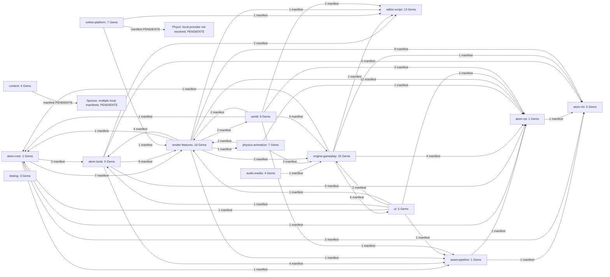

## Dónde y cuándo

| Arista | Fase | Qué demuestra |
|---|---|---|
| manifest-dependency / selection-root | configure/selección | dependencia declarada y alcance por nombres locales |
| manifest-external-subdirectory | configure/discovery | catálogo disponible, no activación |
| cmake-* | configure/link declarado | referencia literal y comando con archivo/línea; condiciones no evaluadas |
| configured-module-composition | plan de carga generado | host, target y DLL planificados; no carga realmente observada |
| cpp-factory-call | registro estático en runtime/Editor/asset processing | sitio real y argumento; false de Bootstrap registra sin Required |
| runtime-ebus-contract | inicialización de viewport | contrato trazado; receptor efectivo y timing siguen delimitados |
| native-absorption-evidence | owner/integración | owner actual y alcance histórico documentado |

Cada arista está en [edges.json](edges.json) con `file`, `line`, `phase`, `kind`, `resolution` y detalle. [cmake-reference-contexts.json](cmake-reference-contexts.json) conserva el comando completo para no confundir link con llamadas. [configured-module-composition.json](configured-module-composition.json) enumera todos los targets/DLL de los planes capturados.

## Registro estático por host

Sitios C++ verificados con la cobertura Graft reutilizada y SHA actual. Registro de módulo no equivale por sí solo a activar todos sus componentes.

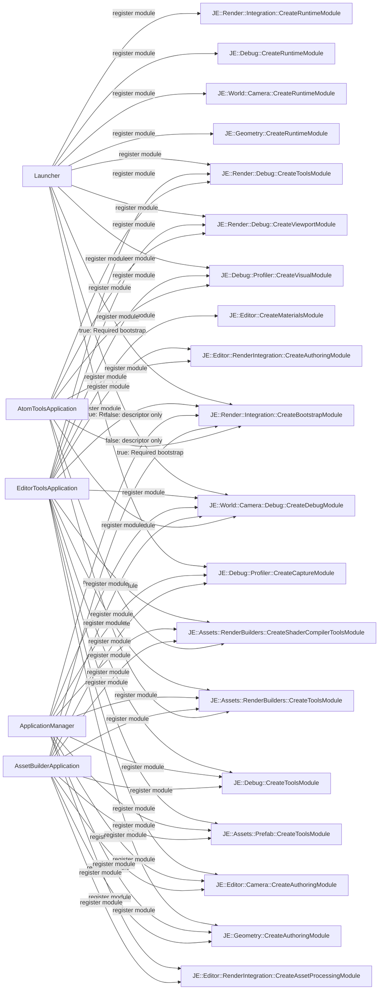

| Host / archivo | Línea Bootstrap | Modo | Fase |
|---|---|---|---|
| `Code/LauncherUnified/Launcher.cpp` | 85 | true por default: Required bootstrap | runtime/non-headless-static-module-registration |
| `Code/Editor/EditorToolsApplication.cpp` | 127 | true por default: Required bootstrap | Editor/tools-static-module-registration |
| `Code/Tools/AssetProcessor/native/utilities/ApplicationManager.cpp` | 234 | false: descriptor sin Required | asset-processing/static-module-registration |
| `Code/Tools/AssetProcessor/AssetBuilder/AssetBuilderApplication.cpp` | 134 | false: descriptor sin Required | asset-processing/static-module-registration |
| `Gems/Atom/Tools/AtomToolsFramework/Code/Source/Application/AtomToolsApplication.cpp` | 174 | true por default: Required bootstrap | Editor/tools-static-module-registration |

## Catálogo completo

| Gem | Familia | Configurado | Alcance desde manifests | Estado nativo | Fuente |
|---|---|---|---|---|---|
| Achievements | online-platform | 0 hosts |  | Gem presente; no aceptación inferida | `Gems/Achievements/gem.json` |
| AFR | engine-gameplay | 0 hosts |  | Gem presente; no aceptación inferida | `Gems/AFR/gem.json` |
| Archive | engine-gameplay | 0 hosts | selection:project:AutomatedTesting | Gem presente; no aceptación inferida | `Gems/Archive/gem.json` |
| AssetValidation | engine-gameplay | 0 hosts |  | Gem presente; no aceptación inferida | `Gems/AssetValidation/gem.json` |
| Atom | atom-core | 22 hosts | selection:engine, selection:project:AutomatedTesting, selection:project:JEEditorFixture | Gem presente; no aceptación inferida | `Gems/Atom/gem.json` |
| Atom_Feature_Common | render-features | 22 hosts | selection:engine, selection:project:AutomatedTesting, selection:project:JEEditorFixture | Gem presente; no aceptación inferida | `Gems/Atom/Feature/Common/gem.json` |
| Atom_RHI | atom-rhi | 22 hosts | selection:engine, selection:project:AutomatedTesting, selection:project:JEEditorFixture | Gem presente; no aceptación inferida | `Gems/Atom/RHI/gem.json` |
| Atom_RHI_DX12 | atom-rhi | 0 hosts | selection:engine, selection:project:AutomatedTesting, selection:project:JEEditorFixture | Gem presente; no aceptación inferida | `Gems/Atom/RHI/DX12/gem.json` |
| Atom_RHI_Metal | atom-rhi | 0 hosts | selection:engine, selection:project:AutomatedTesting, selection:project:JEEditorFixture | Gem presente; no aceptación inferida | `Gems/Atom/RHI/Metal/gem.json` |
| Atom_RHI_Null | atom-rhi | 10 hosts | selection:engine, selection:project:AutomatedTesting, selection:project:JEEditorFixture | Gem presente; no aceptación inferida | `Gems/Atom/RHI/Null/gem.json` |
| Atom_RHI_Vulkan | atom-rhi | 22 hosts | selection:engine, selection:project:AutomatedTesting, selection:project:JEEditorFixture | Gem presente; no aceptación inferida | `Gems/Atom/RHI/Vulkan/gem.json` |
| Atom_RPI | atom-rpi | 22 hosts | selection:engine, selection:project:AutomatedTesting, selection:project:JEEditorFixture | Gem presente; no aceptación inferida | `Gems/Atom/RPI/gem.json` |
| Atom_TestData | content | 0 hosts | selection:project:AutomatedTesting | Gem presente; no aceptación inferida | `Gems/AtomContent/TestData/gem.json` |
| AtomContent | content | 0 hosts |  | Gem presente; no aceptación inferida | `Gems/AtomContent/gem.json` |
| AtomFont | render-features | 22 hosts | selection:engine, selection:project:AutomatedTesting, selection:project:JEEditorFixture | Gem presente; no aceptación inferida | `Gems/AtomLyIntegration/AtomFont/gem.json` |
| AtomLyIntegration | render-features | 0 hosts |  | Gem presente; no aceptación inferida | `Gems/AtomLyIntegration/gem.json` |
| AtomRenderOptions | render-features | 20 hosts | selection:engine, selection:project:AutomatedTesting, selection:project:JEEditorFixture | Gem presente; no aceptación inferida | `Gems/AtomLyIntegration/AtomRenderOptions/gem.json` |
| AtomToolsFramework | atom-tools | 20 hosts | selection:engine, selection:project:AutomatedTesting, selection:project:JEEditorFixture | Gem presente; no aceptación inferida | `Gems/Atom/Tools/AtomToolsFramework/gem.json` |
| AtomTressFX | render-features | 0 hosts | selection:project:AutomatedTesting | Gem presente; no aceptación inferida | `Gems/AtomTressFX/gem.json` |
| AtomViewportDisplayIcons | render-features | 20 hosts | selection:engine, selection:project:AutomatedTesting, selection:project:JEEditorFixture | Gem presente; no aceptación inferida | `Gems/AtomLyIntegration/AtomViewportDisplayIcons/gem.json` |
| AtomViewportDisplayInfo | render-features | 22 hosts | selection:engine, selection:project:AutomatedTesting, selection:project:JEEditorFixture | Gem presente; no aceptación inferida | `Gems/AtomLyIntegration/AtomViewportDisplayInfo/gem.json` |
| AudioSystem | audio-media | 11 hosts | selection:engine, selection:project:AutomatedTesting | Gem presente; no aceptación inferida | `Gems/AudioSystem/gem.json` |
| AutomatedTesting | testing | 0 hosts | selection:project:AutomatedTesting | Gem presente; no aceptación inferida | `AutomatedTesting/Gem/gem.json` |
| BarrierInput | engine-gameplay | 0 hosts |  | Gem presente; no aceptación inferida | `Gems/BarrierInput/gem.json` |
| Camera | engine-gameplay | 0 hosts |  | published bounded integration slice; global gates remain open | `Gems/Camera/gem.json` |
| CameraFramework | engine-gameplay | 0 hosts |  | published bounded integration slice; global gates remain open | `Gems/CameraFramework/gem.json` |
| CertificateManager | online-platform | 0 hosts | selection:project:AutomatedTesting | Gem presente; no aceptación inferida | `Gems/CertificateManager/gem.json` |
| CommonFeaturesAtom | render-features | 22 hosts | selection:engine, selection:project:AutomatedTesting, selection:project:JEEditorFixture | Gem presente; no aceptación inferida | `Gems/AtomLyIntegration/CommonFeatures/gem.json` |
| Compression | engine-gameplay | 0 hosts | selection:project:AutomatedTesting | Gem presente; no aceptación inferida | `Gems/Compression/gem.json` |
| CrashReporting | engine-gameplay | 0 hosts |  | Gem presente; no aceptación inferida | `Gems/CrashReporting/gem.json` |
| CustomAssetExample | engine-gameplay | 0 hosts |  | Gem presente; no aceptación inferida | `Gems/CustomAssetExample/gem.json` |
| DccScriptingInterface | render-features | 0 hosts |  | Gem presente; no aceptación inferida | `Gems/AtomLyIntegration/TechnicalArt/DccScriptingInterface/gem.json` |
| DebugDraw | render-features | 0 hosts | selection:project:AutomatedTesting | Gem presente; no aceptación inferida | `Gems/DebugDraw/gem.json` |
| DevTextures | engine-gameplay | 0 hosts | selection:project:AutomatedTesting | Gem presente; no aceptación inferida | `Gems/DevTextures/gem.json` |
| DiffuseProbeGrid | render-features | 0 hosts | selection:project:AutomatedTesting | Gem presente; no aceptación inferida | `Gems/DiffuseProbeGrid/gem.json` |
| EditorModeFeedback | render-features | 10 hosts | selection:engine, selection:project:AutomatedTesting | Gem presente; no aceptación inferida | `Gems/AtomLyIntegration/EditorModeFeedback/gem.json` |
| EditorPythonBindings | editor-script | 0 hosts | selection:project:AutomatedTesting | Gem presente; no aceptación inferida | `Gems/EditorPythonBindings/gem.json` |
| EMotionFX | physics-animation | 22 hosts | selection:engine, selection:project:AutomatedTesting, selection:project:JEEditorFixture | Gem presente; no aceptación inferida | `Gems/EMotionFX/gem.json` |
| EMotionFX_Atom | render-features | 22 hosts | selection:engine, selection:project:AutomatedTesting, selection:project:JEEditorFixture | Gem presente; no aceptación inferida | `Gems/AtomLyIntegration/EMotionFXAtom/gem.json` |
| ExpressionEvaluation | editor-script | 0 hosts | selection:project:AutomatedTesting | Gem presente; no aceptación inferida | `Gems/ExpressionEvaluation/gem.json` |
| FastNoise | world | 0 hosts | selection:project:AutomatedTesting | Gem presente; no aceptación inferida | `Gems/FastNoise/gem.json` |
| GameState | engine-gameplay | 0 hosts |  | Gem presente; no aceptación inferida | `Gems/GameState/gem.json` |
| GameStateSamples | engine-gameplay | 0 hosts |  | Gem presente; no aceptación inferida | `Gems/GameStateSamples/gem.json` |
| Gestures | engine-gameplay | 0 hosts | selection:project:AutomatedTesting | Gem presente; no aceptación inferida | `Gems/Gestures/gem.json` |
| GradientSignal | world | 22 hosts | selection:engine, selection:project:AutomatedTesting, selection:project:JEEditorFixture | Gem presente; no aceptación inferida | `Gems/GradientSignal/gem.json` |
| GraphCanvas | editor-script | 20 hosts | selection:engine, selection:project:AutomatedTesting, selection:project:JEEditorFixture | Gem presente; no aceptación inferida | `Gems/GraphCanvas/gem.json` |
| GraphModel | editor-script | 20 hosts | selection:engine, selection:project:AutomatedTesting, selection:project:JEEditorFixture | Gem presente; no aceptación inferida | `Gems/GraphModel/gem.json` |
| ImageProcessingAtom | asset-pipeline | 20 hosts | selection:engine, selection:project:AutomatedTesting, selection:project:JEEditorFixture | Gem presente; no aceptación inferida | `Gems/Atom/Asset/ImageProcessingAtom/gem.json` |
| ImGui | engine-gameplay | 0 hosts |  | published bounded integration slice; global gates remain open | `Gems/ImGui/gem.json` |
| InAppPurchases | online-platform | 0 hosts | selection:project:AutomatedTesting | Gem presente; no aceptación inferida | `Gems/InAppPurchases/gem.json` |
| LandscapeCanvas | world | 0 hosts | selection:project:AutomatedTesting | Gem presente; no aceptación inferida | `Gems/LandscapeCanvas/gem.json` |
| LmbrCentral | engine-gameplay | 22 hosts | selection:engine, selection:project:AutomatedTesting, selection:project:JEEditorFixture | Gem presente; no aceptación inferida | `Gems/LmbrCentral/gem.json` |
| LocalUser | engine-gameplay | 0 hosts |  | Gem presente; no aceptación inferida | `Gems/LocalUser/gem.json` |
| LyShine | ui | 0 hosts | selection:project:AutomatedTesting | Gem presente; no aceptación inferida | `Gems/LyShine/gem.json` |
| LyShineExamples | ui | 0 hosts | selection:project:AutomatedTesting | Gem presente; no aceptación inferida | `Gems/LyShineExamples/gem.json` |
| Maestro | engine-gameplay | 11 hosts | selection:engine, selection:project:AutomatedTesting | Gem presente; no aceptación inferida | `Gems/Maestro/gem.json` |
| MaterialCanvas | atom-tools | 0 hosts |  | Gem presente; no aceptación inferida | `Gems/Atom/Tools/MaterialCanvas/gem.json` |
| MaterialEditor | atom-tools | 0 hosts |  | workspace-slice-published; metadata-wrapper-still-present | `Gems/Atom/Tools/MaterialEditor/gem.json` |
| Meshlets | render-features | 0 hosts |  | Gem presente; no aceptación inferida | `Gems/Meshlets/gem.json` |
| MessagePopup | ui | 0 hosts |  | Gem presente; no aceptación inferida | `Gems/MessagePopup/gem.json` |
| Microphone | audio-media | 0 hosts |  | Gem presente; no aceptación inferida | `Gems/Microphone/gem.json` |
| MiniAudio | audio-media | 0 hosts |  | Gem presente; no aceptación inferida | `Gems/MiniAudio/gem.json` |
| MotionMatching | physics-animation | 0 hosts |  | Gem presente; no aceptación inferida | `Gems/MotionMatching/gem.json` |
| Multiplayer | online-platform | 0 hosts | selection:project:AutomatedTesting | Gem presente; no aceptación inferida | `Gems/Multiplayer/gem.json` |
| Multiplayer_ScriptCanvas | online-platform | 0 hosts |  | Gem presente; no aceptación inferida | `Gems/Multiplayer/Multiplayer_ScriptCanvas/gem.json` |
| MultiplayerCompression | online-platform | 0 hosts |  | Gem presente; no aceptación inferida | `Gems/MultiplayerCompression/gem.json` |
| NvCloth | physics-animation | 0 hosts | selection:project:AutomatedTesting | Gem presente; no aceptación inferida | `Gems/NvCloth/gem.json` |
| OpenParticleSystem | engine-gameplay | 0 hosts | selection:project:AutomatedTesting | Gem presente; no aceptación inferida | `Gems/OpenParticleSystem/gem.json` |
| PassCanvas | atom-tools | 0 hosts |  | Gem presente; no aceptación inferida | `Gems/Atom/Tools/PassCanvas/gem.json` |
| PhysX5 | physics-animation | 11 hosts | selection:project:AutomatedTesting, selection:project:JEEditorFixture | Gem presente; no aceptación inferida | `Gems/PhysX/Core/PhysX5/gem.json` |
| PhysX5Debug | physics-animation | 0 hosts | selection:project:AutomatedTesting | Gem presente; no aceptación inferida | `Gems/PhysX/Debug/PhysX5/gem.json` |
| PhysXCommon | physics-animation | 5 hosts | selection:project:AutomatedTesting, selection:project:JEEditorFixture | Gem presente; no aceptación inferida | `Gems/PhysX/Common/gem.json` |
| PrefabBuilder | engine-gameplay | 0 hosts |  | published bounded integration slice; global gates remain open | `Gems/Prefab/PrefabBuilder/gem.json` |
| Presence | online-platform | 0 hosts |  | Gem presente; no aceptación inferida | `Gems/Presence/gem.json` |
| PrimitiveAssets | engine-gameplay | 0 hosts |  | published bounded integration slice; global gates remain open | `Gems/PrimitiveAssets/gem.json` |
| PythonAssetBuilder | editor-script | 0 hosts | selection:project:AutomatedTesting | Gem presente; no aceptación inferida | `Gems/PythonAssetBuilder/gem.json` |
| PythonCoverage | testing | 0 hosts | selection:project:AutomatedTesting | Gem presente; no aceptación inferida | `AutomatedTesting/Gem/PythonCoverage/gem.json` |
| QtForPython | editor-script | 0 hosts | selection:project:AutomatedTesting | Gem presente; no aceptación inferida | `Gems/QtForPython/gem.json` |
| RecastNavigation | physics-animation | 0 hosts | selection:project:AutomatedTesting | Gem presente; no aceptación inferida | `Gems/RecastNavigation/gem.json` |
| ReferenceMaterials | content | 0 hosts |  | Gem presente; no aceptación inferida | `Gems/AtomContent/ReferenceMaterials/gem.json` |
| RemoteTools | engine-gameplay | 0 hosts | selection:project:AutomatedTesting | Gem presente; no aceptación inferida | `Gems/RemoteTools/gem.json` |
| SaveData | engine-gameplay | 0 hosts |  | Gem presente; no aceptación inferida | `Gems/SaveData/gem.json` |
| SceneLoggingExample | engine-gameplay | 0 hosts |  | Gem presente; no aceptación inferida | `Gems/SceneLoggingExample/gem.json` |
| SceneProcessing | engine-gameplay | 10 hosts | selection:engine, selection:project:AutomatedTesting | Gem presente; no aceptación inferida | `Gems/SceneProcessing/gem.json` |
| ScriptAutomation | editor-script | 0 hosts | selection:project:AutomatedTesting | Gem presente; no aceptación inferida | `Gems/ScriptAutomation/gem.json` |
| ScriptCanvas | editor-script | 0 hosts | selection:project:AutomatedTesting | Gem presente; no aceptación inferida | `Gems/ScriptCanvas/gem.json` |
| ScriptCanvasDeveloper | editor-script | 0 hosts |  | Gem presente; no aceptación inferida | `Gems/ScriptCanvasDeveloper/gem.json` |
| ScriptCanvasPhysics | editor-script | 0 hosts | selection:project:AutomatedTesting | Gem presente; no aceptación inferida | `Gems/ScriptCanvasPhysics/gem.json` |
| ScriptCanvasTesting | editor-script | 0 hosts | selection:project:AutomatedTesting | Gem presente; no aceptación inferida | `Gems/ScriptCanvasTesting/gem.json` |
| ScriptedEntityTweener | editor-script | 0 hosts |  | Gem presente; no aceptación inferida | `Gems/ScriptedEntityTweener/gem.json` |
| ScriptEvents | editor-script | 0 hosts | selection:project:AutomatedTesting | Gem presente; no aceptación inferida | `Gems/ScriptEvents/gem.json` |
| ShaderManagementConsole | atom-tools | 20 hosts | selection:engine, selection:project:AutomatedTesting, selection:project:JEEditorFixture | Gem presente; no aceptación inferida | `Gems/Atom/Tools/ShaderManagementConsole/gem.json` |
| SkyAtmosphere | render-features | 0 hosts | selection:project:AutomatedTesting | Gem presente; no aceptación inferida | `Gems/SkyAtmosphere/gem.json` |
| Sponza | content | 0 hosts |  | Gem presente; no aceptación inferida | `Gems/AtomContent/Sponza/gem.json` |
| Sponza | testing | 0 hosts |  | Gem presente; no aceptación inferida | `AutomatedTesting/Gem/Sponza/gem.json` |
| Stars | render-features | 0 hosts | selection:project:AutomatedTesting | Gem presente; no aceptación inferida | `Gems/Stars/gem.json` |
| StartingPointCamera | engine-gameplay | 0 hosts | selection:project:AutomatedTesting | Gem presente; no aceptación inferida | `Gems/StartingPointCamera/gem.json` |
| StartingPointInput | engine-gameplay | 0 hosts | selection:project:AutomatedTesting | Gem presente; no aceptación inferida | `Gems/StartingPointInput/gem.json` |
| StartingPointMovement | engine-gameplay | 0 hosts | selection:project:AutomatedTesting | Gem presente; no aceptación inferida | `Gems/StartingPointMovement/gem.json` |
| Streamer | engine-gameplay | 0 hosts |  | Gem presente; no aceptación inferida | `Gems/Streamer/gem.json` |
| StreamerProfiler | engine-gameplay | 0 hosts |  | Gem presente; no aceptación inferida | `Gems/Streamer/StreamerProfiler/gem.json` |
| SurfaceData | world | 22 hosts | selection:engine, selection:project:AutomatedTesting, selection:project:JEEditorFixture | Gem presente; no aceptación inferida | `Gems/SurfaceData/gem.json` |
| Terrain | world | 0 hosts | selection:project:AutomatedTesting | Gem presente; no aceptación inferida | `Gems/Terrain/gem.json` |
| TestAssetBuilder | engine-gameplay | 0 hosts | selection:project:AutomatedTesting | Gem presente; no aceptación inferida | `Gems/TestAssetBuilder/gem.json` |
| TextureAtlas | ui | 0 hosts | selection:project:AutomatedTesting | Gem presente; no aceptación inferida | `Gems/TextureAtlas/gem.json` |
| TickBusOrderViewer | engine-gameplay | 0 hosts |  | Gem presente; no aceptación inferida | `Gems/TickBusOrderViewer/gem.json` |
| UiBasics | ui | 0 hosts | selection:project:AutomatedTesting | Gem presente; no aceptación inferida | `Gems/UiBasics/gem.json` |
| Vegetation | world | 0 hosts | selection:project:AutomatedTesting | Gem presente; no aceptación inferida | `Gems/Vegetation/gem.json` |
| VideoPlaybackFramework | audio-media | 0 hosts |  | Gem presente; no aceptación inferida | `Gems/VideoPlaybackFramework/gem.json` |
| VirtualGamepad | engine-gameplay | 0 hosts |  | Gem presente; no aceptación inferida | `Gems/VirtualGamepad/gem.json` |

## asset-pipeline

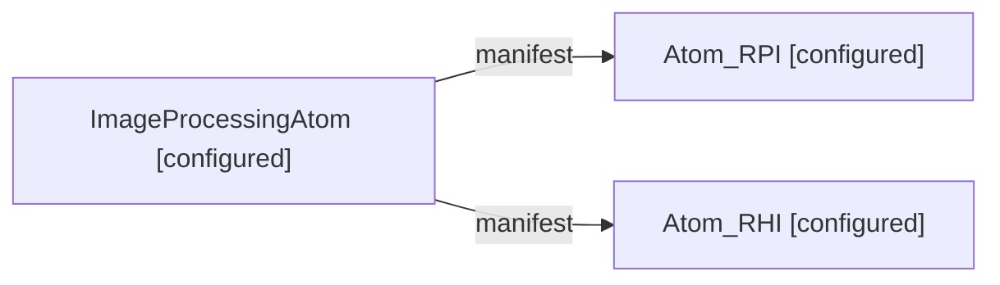

## atom-core

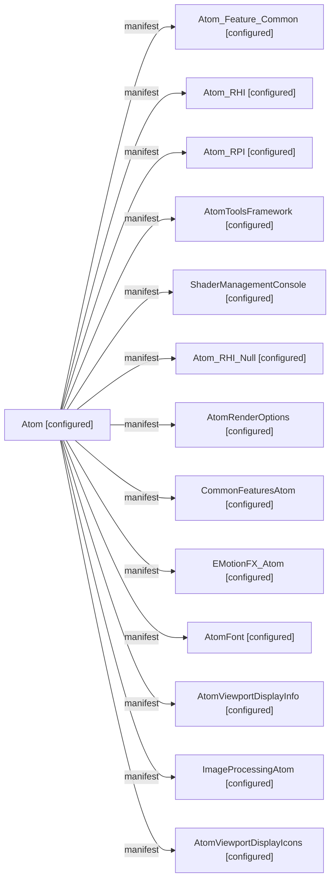

## atom-rhi

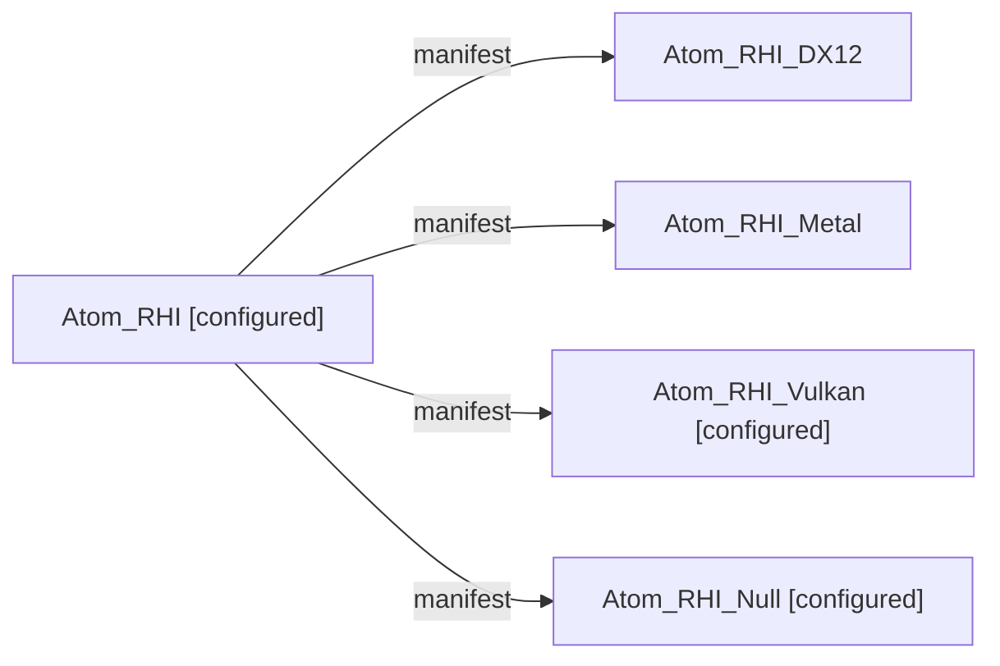

## atom-rpi

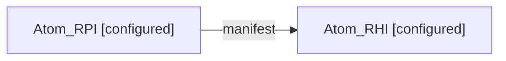

## atom-tools

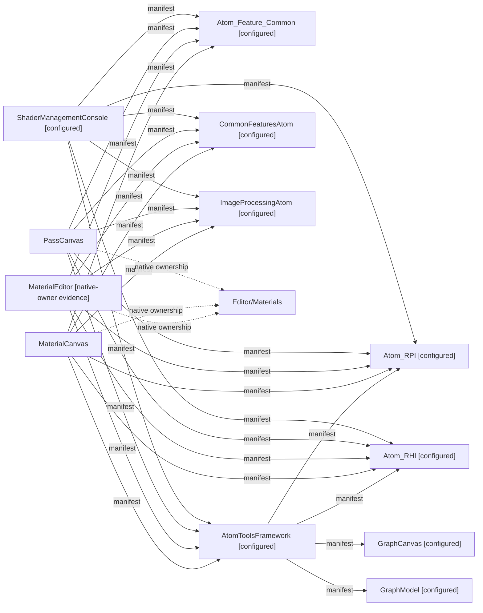

## audio-media

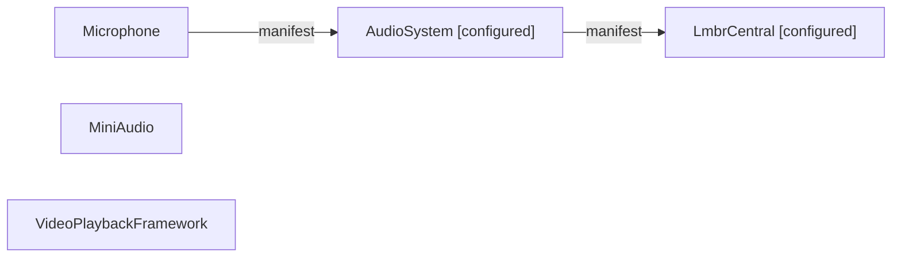

## content

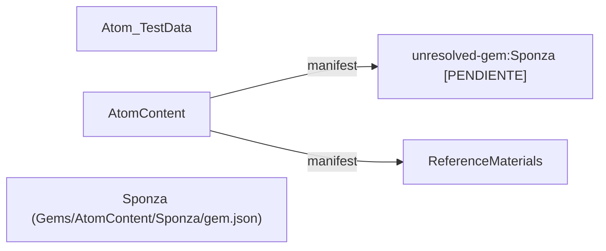

## editor-script

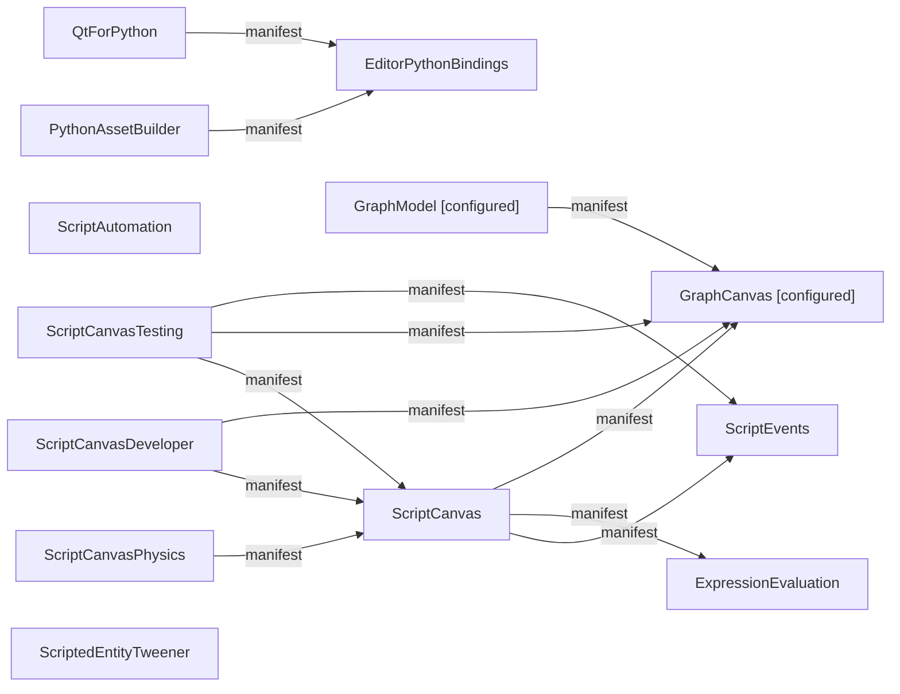

## engine-gameplay

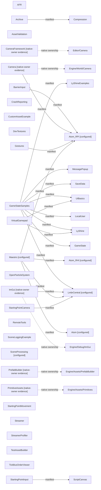

## online-platform

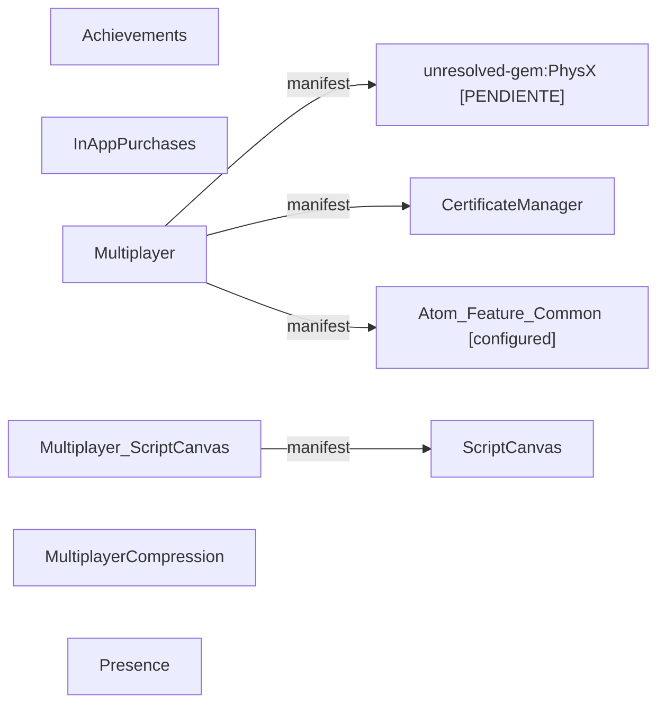

## physics-animation

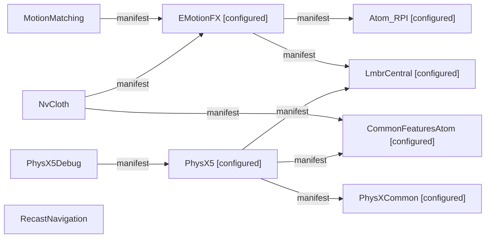

## render-features

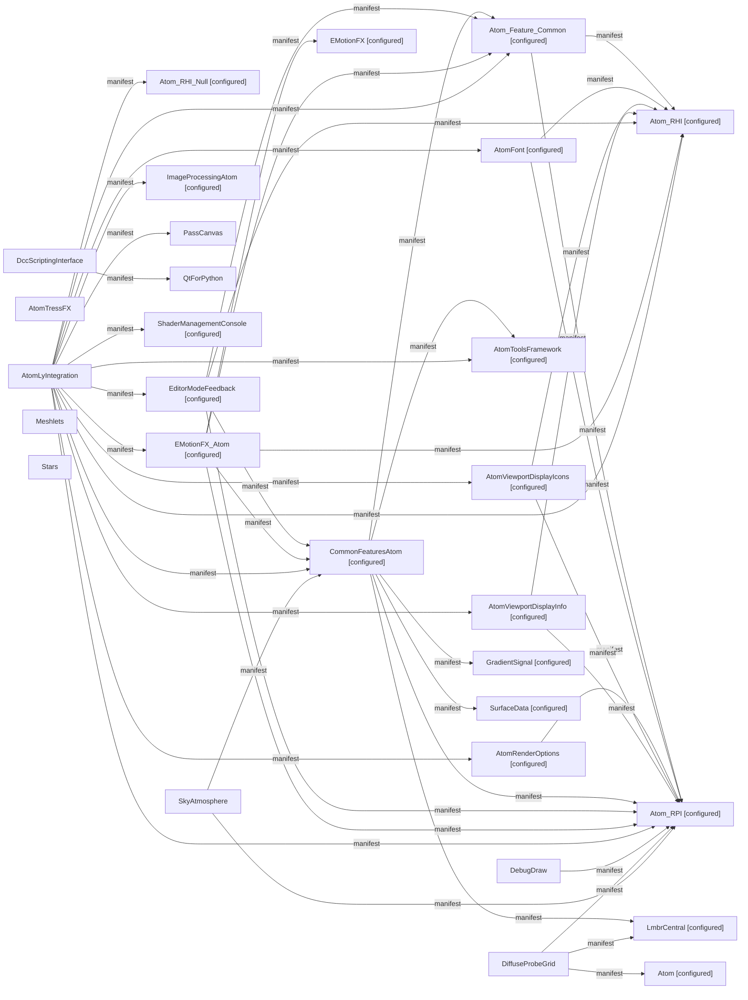

## testing

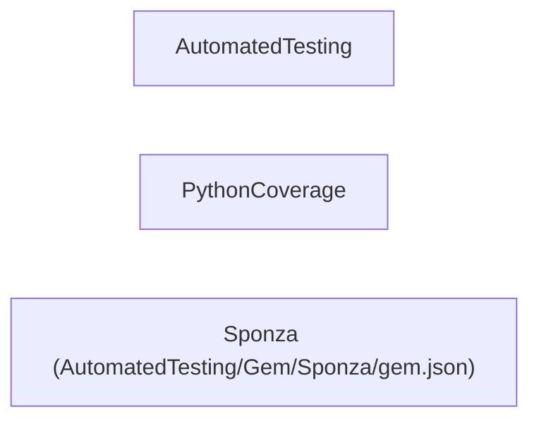

## ui

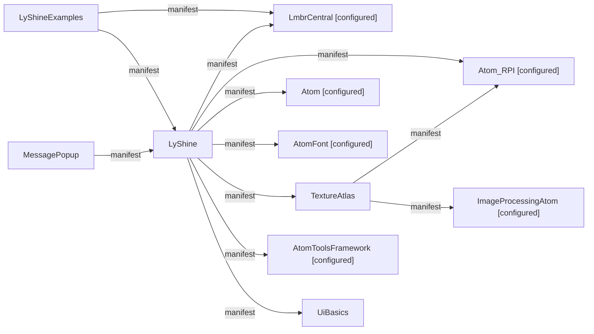

## world

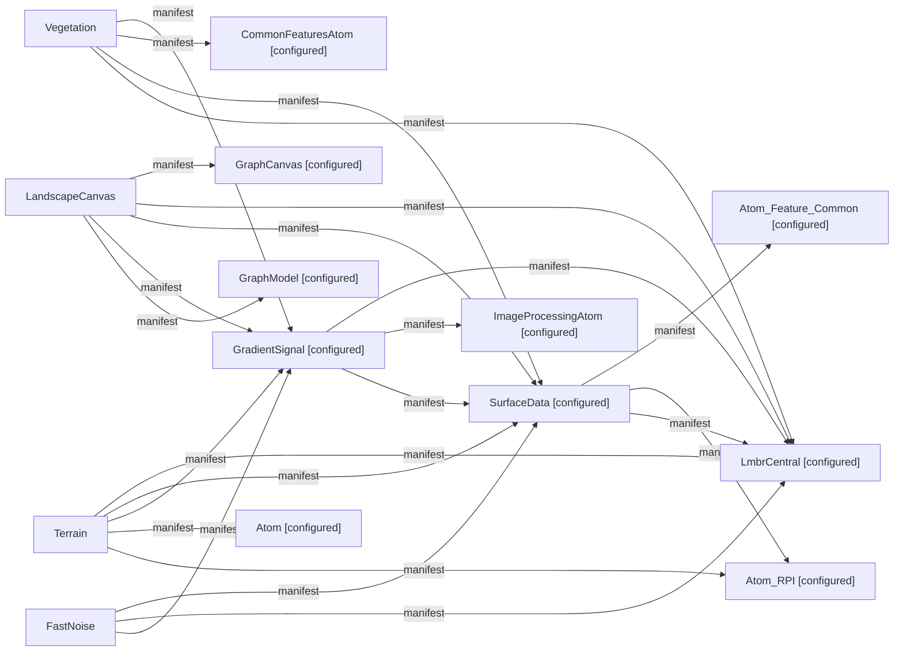

## native-absorptions

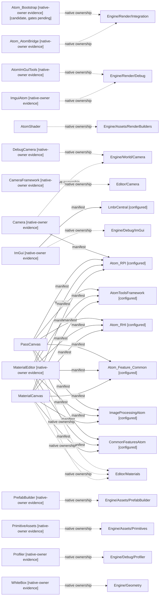

## Límites verificables

- Inventario de manifests completo para Gems/Engine/Editor/Code/Projects/AutomatedTesting/Tools/Templates del checkout, excluyendo Cache/user/build y terceros; fixtures y plantillas no se cuentan como Gems productivas. No incluye Gems instaladas fuera del checkout.
- CMake se inspecciona como fuente, no se ejecuta un evaluador alternativo. Alias, variables y ramas dinámicas pueden requerir resolución adicional; las referencias extraídas no prueban que el target se enlace en la plataforma actual.
- DX12/Metal/Null y capacidades online/Python siguen inventariadas aunque no formen parte del runtime Vulkan autorizado. Presencia de manifest no equivale a aceptación ni habilitación.
- No se demuestra un callgraph C++ absoluto: EBuses, callbacks, factories, reflection y assets requieren trazas por contrato. Este mapa conserva esa frontera PENDIENTE en lugar de inventar aristas.
- Passes, material types, materiales y otras fuentes de authoring siguen siendo datos editables; un archivo JSON no es por sí mismo configuración fija sobrante. Este inventario no prescribe eliminarlo.
- Build94 estaba activo durante la lectura. No se ejecutó configure/build/test/GUI ni se leyó su resultado como cerrado. Los hashes detectan cambios en metadatos capturados; cualquier drift invalida esa parte de la captura.
- La evidencia histórica tiene fecha y alcance propios; no sustituye gates runtime/Ready/SDK/Beauty/performance/VR/Linux/Shipping abiertos.

## Delta98 — inicialización RPI nativa (16/10/2026)

El mapa anterior sigue siendo su snapshot estático; este delta registra el ownership verificado sin inventar un callgraph completo. Las dos activaciones Atom_RPI.Private/Editor ya no forman parte de los22 planes actuales de once ejecutables. Las cinco funciones de host enlazan las factorías nativas antes de Bootstrap. Public/Edit/assets/Registry/manifest siguen residuales; Atom_RPI continúa PARTIAL y el incremento de Gems completas es0.

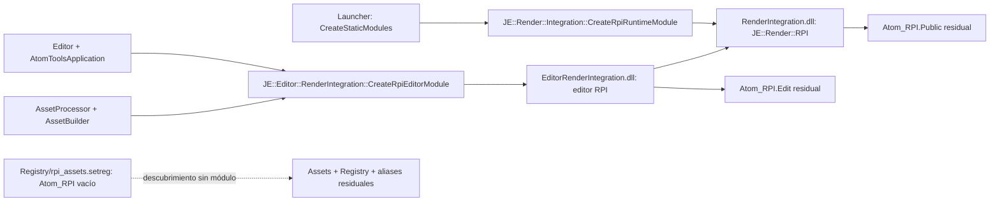

Pruebas588/588, PE/consumidor SDK focal, Editor/White Box/Material Workspace y runtime Vulkan reales. Dos DLL de módulos menos; no se afirma absorción de todo Atom, cierre SDK packaging, AP global, Linux, VR, Shipping ni mejora global de RAM. La evidencia y límites están en [corte98](../../evidence/n0/native-rpi-initialization-2026-10-16/README.md). Reutilizar SDK96; no repetir install/configure/build por cambios que no invalidan esa evidencia.