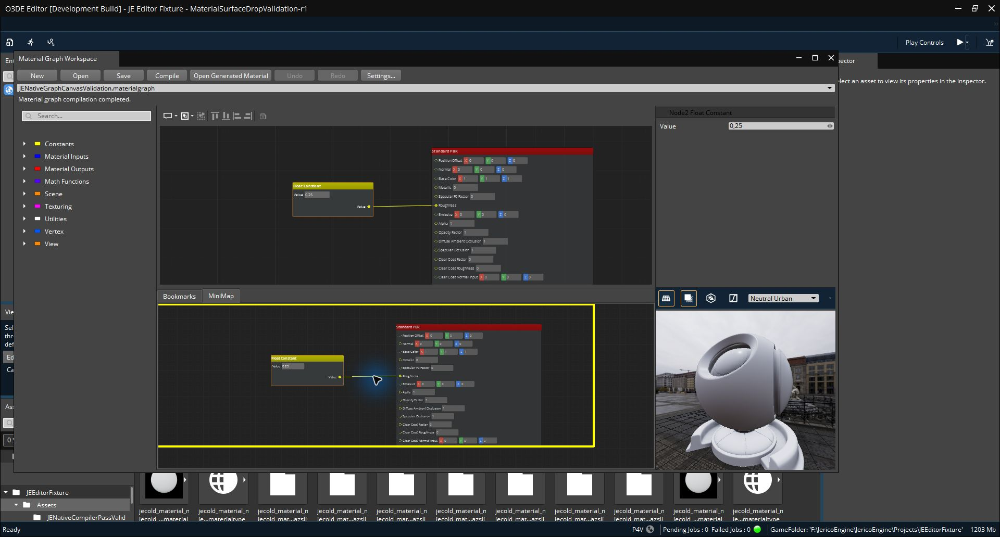

# MaterialCanvas — integración nativa Windows/Profile/Vulkan

Integración verificada para este corte; no aceptación global de todas las plataformas ni del GOAL. Owner: `JE::EditorMaterials`, con la infraestructura compartida `JE::Editor::Tools::GraphCanvas` y el proveedor geométrico `JE::Geometry`. La publicación conjunta conserva los prerrequisitos compilados de SurfaceData; no declara terminados sus escenarios T3 ni su presupuesto de rendimiento.

El shell `Gems/Atom/Tools/MaterialCanvas`, sus entradas de discovery y los registros legacy redundantes se retiran en favor de la autoría existente. Se conservan assets, QRC, identidad de escaneo, documentos, compilación y preview nativos. No se incorpora el trabajo pendiente de PassCanvas ni el benchmark S3 privado.

## Evidencia aceptada y límites

| Gate | Evidencia | Resultado y alcance |
|---|---|---|
| Autoría instalada | [authoring-r2.json](authoring-r2.json) | Edición, Undo/Redo, Save, cierre/reapertura y preview automático reversible; sin abrir manualmente el material generado. |
| Material sobre BSP | [bsp-r4.json](bsp-r4.json) | Aplicación, Undo/Redo, Save/reopen; slot y política PreLoad preservados. Corrección independiente ya publicada en `0414491c6ffca2b0377bcbfb3b7e7f16161638d2`. |
| SDK privado actual | [installed-consumer-r3.json](installed-consumer-r3.json) | Consumidores focales materials/surface/model-volumes; límites y comprobaciones source-free detallados en el recibo. No equivale al SDK global. |
| Grafo y cierre del editor | [preview-gui4.json](preview-gui4.json) | Grafo existente Float 0.25 → Standard PBR Roughness, compilación automática y preview Vulkan. Seis procesos terminados con código 0; 28 originales protegidos, sin deriva ni cierre forzado. |
| Launcher Vulkan | [runtime-parent-review.json](runtime-parent-review.json), [resultado nativo](runtime-native-result.json), [postflight](runtime-postflight.json) | Escena visible; menú Sistema → Cerrar observado como SC_CLOSE, WM_CLOSE y Bootstrap::OnWindowClosed. Proceso nativo terminó con código 0, sin timeout ni guard; entradas congeladas intactas y censo vacío. |

La captura original del launcher se conserva localmente en `build/n0-validation/native-corefeature102/vulkan-runtime-close-r4-attempt1/before-close.jpg`; no se añade un objeto LFS nuevo para esta publicación.

La captura publicada conserva su resolución original. No es una prueba de percentiles CPU/GPU ni de rendimiento sostenido. Se conservan los avisos conocidos de atributos Vulkan no utilizados y DynamicDrawContext al cierre; no se afirma ausencia total de warnings.

El intento R3 anterior terminó por timeout y no se acredita como cierre correcto. En R4 los gestos anteriores sobre X/Alt+F4 no produjeron una traza de cierre: no bastaban para atribuir un bloqueo al motor. El cierre observado desde el menú del sistema y el resultado del proceso original son la evidencia discriminante; no se necesitó modificar el shutdown del producto.

## Pendientes separados

SurfaceData T3, cargas densas/budgets, integración posterior PWAS/EPLS, teclado físico aplazado de GraphCanvas, Linux Vulkan, VR/headset, Shipping y aceptación global N0/SDK conservan sus gates. No se incrementa el contador de Gems globalmente completas ni se inventa un total pendiente.

Los hashes de los ocho artefactos copiados figuran en [manifest.json](manifest.json). Los recibos conservan sus rutas y cohortes originales; las pruebas anteriores no se reasignan a otros binarios.
